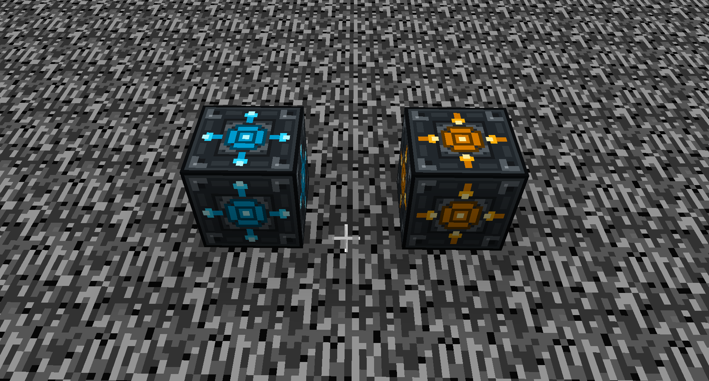
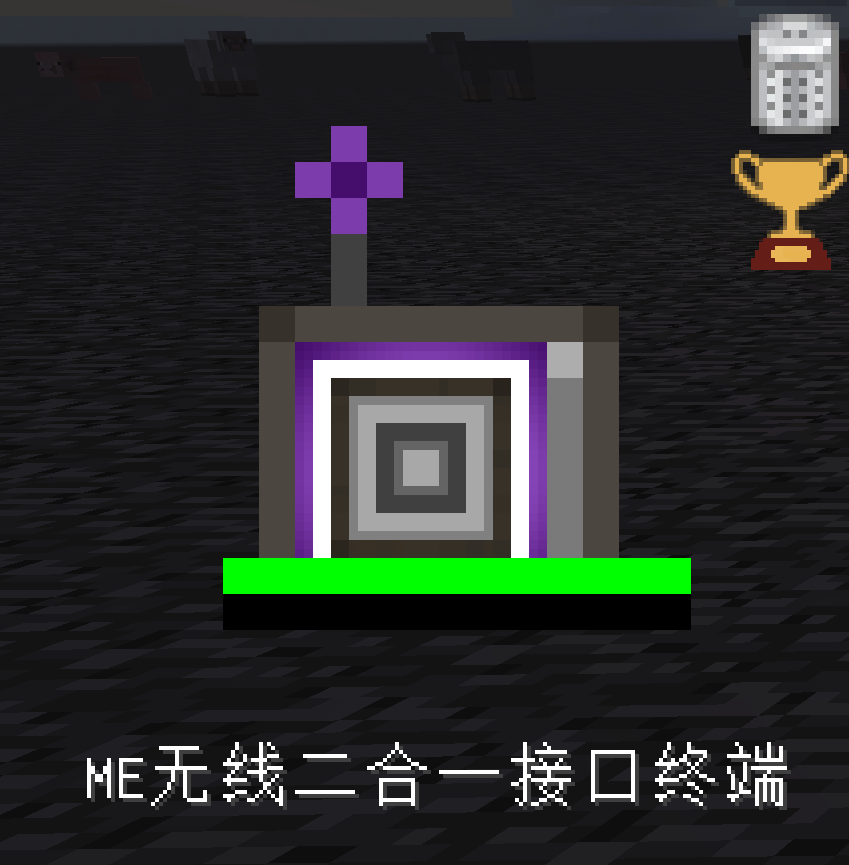
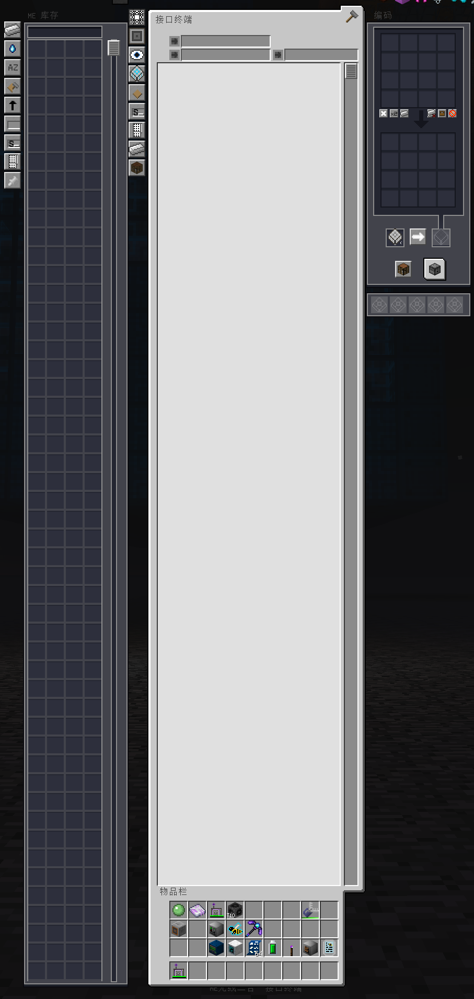
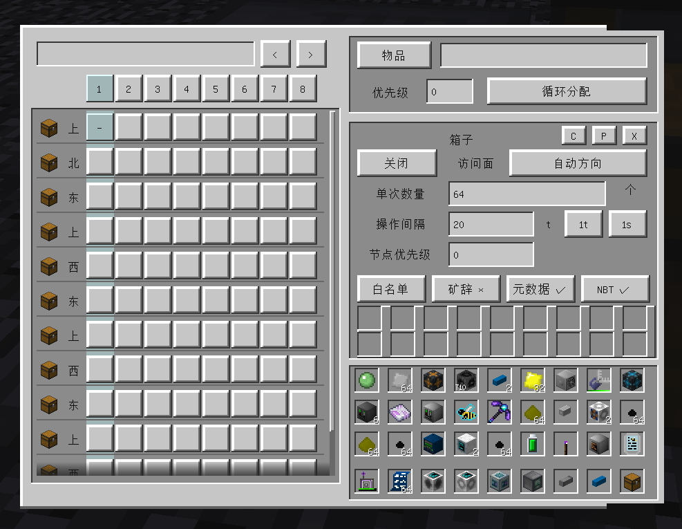
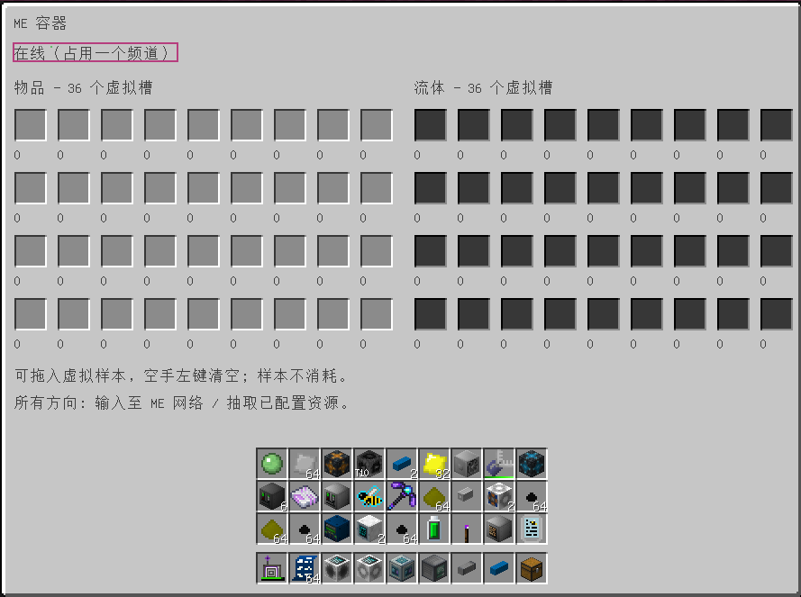
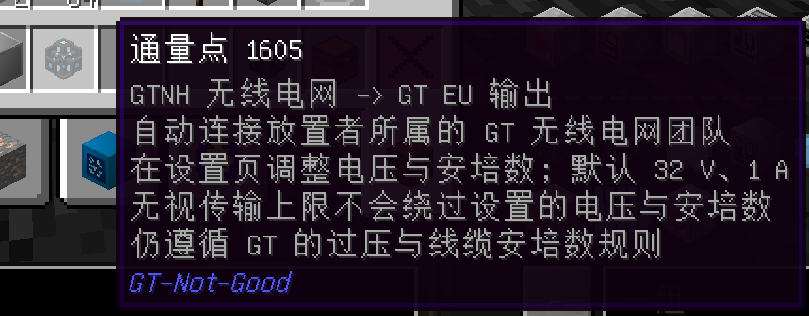
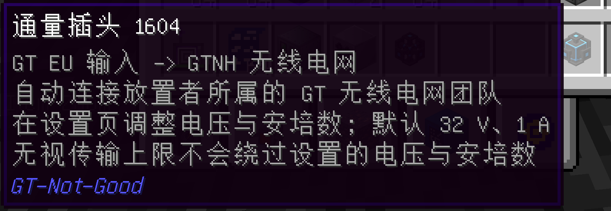
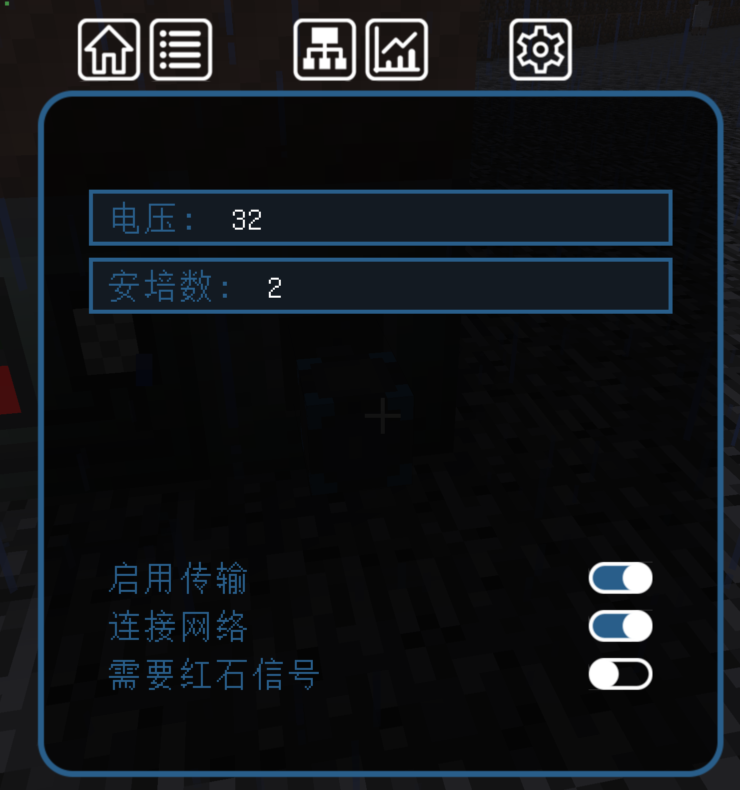

# GT-Not-Good
看名字你应该知道就是抄袭GTNL的模组

本模组大量引用了别人的代码甚至可以说抄袭 代码都是ai跑的

如有违反或让原作者不满 我会立即删除

本项目作自用 大量魔改修改难度

添加自定义任务线  介绍了本mod加了的一些物品方块和机器   加入BetterQuestingAPI这个mod可自动显现!!!
https://github.com/ABKQPO/BetterQuestingAPI

添加了个闪电科技封包功能
神秘时代注魔封包核心
装配线和进阶装配线封包核心
直接给神秘注魔自动化这坨大分杀了  直接给装配线杀了
 

本mod添加了个至尊功能 可以在配置文件关闭
只针对单方块
ae 两个接口对单方块机器下单 直接会在推料之前修改单方块机器里的虚拟编程电路
也就是说类似可编程电路mod  但是不需要额外写一个虚拟编程电路了 一个单方块机器 25种电路配方完全洒洒水啦
遇见bug 即时反馈 

本mod还对单方块机器添加了自己的虚拟模具槽 处于电路槽上方 可参与配方合成

普通 ME 接口和流体接口直连受支持的 GT 电力单方块时，加工样板可保留编程电路和不消耗的模具，AE 合成计划只索取消耗材料；实际作为耗材的模具仍须供应。同张样板后期可直接移入电路样板总成，无需重新编码。详见[使用说明](docs/automatic-machine-circuit.md)。

虚拟模具列表新增 GGFab 的八种一次性工具铸件：锉、扳手、撬棍、剪线钳、锻造锤、软锤、螺丝刀和锯子。
单方块机器和超级样板输入总成均可在虚拟模具选择器中使用。

mixin关闭了配方超净间需求

mixin开启了灵魂瓶能装所有 导致屠宰场所有生物可以有产物

### Current support version
| GTNH Version | Start Version | Newest Support Version |                                                            Download                                                            | Maintenance status |
|:------------:|:-------------:|:----------------------:|:------------------------------------------------------------------------------------------------------------------------------:|:------------------:|
| 2.9.0-beta2  |     1.0.0     |         1.0.1          |  |         ❌          |
| 2.9.0-beta3  |     1.0.3     |         1.1.5          |  |         ✔️         |
|  2.9.0-RC-1  |     1.1.6     |         1.6.2          |  |         ✔️         |
|  2.9.0-RC-2  |     1.6.3     |         1.6.6          |  |         ✔️         |

当前版本面向 GTNH 2.9.0-RC-2；RC1 请使用 1.6.2。

最新版本：[1.6.6 发布说明](https://github.com/ikkkkkkkuuu/GT-Not-Good/releases/tag/1.6.6)。
下载：[游戏用 JAR](https://github.com/ikkkkkkkuuu/GT-Not-Good/releases/download/1.6.6/gtnotgood-1.6.6.jar) · [源码 JAR](https://github.com/ikkkkkkkuuu/GT-Not-Good/releases/download/1.6.6/gtnotgood-1.6.6-sources.jar)。

1.3.4 因启动错误已撤回，请更新到 1.6.6。

> **1.5.1 为破坏性更新：原有保险库结构将失效。** 升级前请备份存档。保留原控制器和端口，将结构中的 **10 个坚实钢机械方块替换为爱丁顿壁外壳**，重新成型并启用机器。物品和流体仍保存在原控制器的存档数据中。

### 1.6.6 更新

- 新增力场压模工厂、维度聚焦激光蚀刻阵列、克尔-纽曼均质仪、超级粒子对撞机、巨型组装厂和超导电磁工厂，保留移植结构、材质及运行特效，并提供控制器和结构件生存配方。
- 新增 46 种模块仓，包含超频、速度、能耗、并行参数仓及三类执行核心；16 种动态仓支持 GUI 调参。主机内置普通核心，附加核心独立加工；高级和完美加工核心使用仓主无线账户预付电量，余额不足不扣料。
- 六台加工机器默认耗时减半、EU/t 乘四，可用超频模块覆盖；取消能源仓数量上限，保留实际功率和最高单仓电压门槛。六台机器及宇宙之心免维护，兼容旧维护仓与维修存档。
- 新增宇宙之心及燃料链，每组燃料约发电 7.56×10²³ EU；普通／高级／完美核心基础释放时间为 60 秒／15 秒／1 tick，基础维持耗电 64A LuV，断电暂停，加速不增加燃料总能量。控制器使用 16,384 桶原生 UU 流体，发电 NEI 说明支持双语折行。
- 新增猎光号空间站、四类枢纽卫星工厂和线程修正仓，支持 20 个连接位、64 星阵、原生配方合批及恒星特效；修正各类能源仓的功率统计与类型识别。压缩星阵所需奥术星图未移植，没有新增压缩星阵产出配方。
- 模块化 GUI 分核心显示独立进度、物品／流体数量和产率，刷新时保留滚动位置；暂停和等待输出时产率归零。大批量产物以大整数合计、分次输出并保存进度，避免溢出与重复结算。
- 完善 TST 模块配方共存，区分电路、保留扫描研究与动态升级成本，避免串方和本模组模块被复制到免研究配方池；无线多安培能源仓显示名称简化为“无线能源仓”。

模块机制与验证范围见[模块化机器检查](docs/testing/modular-machines.md)，猎光号运行规则见[空间站说明](docs/testing/light-hunter-space-station.md)。

### 1.6.5 更新

- 通配符样板支持从 NEI「＋」导入 GT 加工与熔炉配方，自动填写材料前缀、材料流体及数量；电路、不消耗工具和无法安全通配的含 NBT 项保持固定。保留已有过滤条件，调整后点击保存生效，每侧最多 6 项。
- 普通／流体 ME 接口支持通配符样板的固定电路和不消耗模具，合法展开分支仅索取消耗材料；接口朝向或相邻机器变化后刷新识别，原样板可直接移入电路样板总成。
- 修复电路样板总成及普通／流体接口只认配方代表透镜，漏掉合法矿辞替代透镜的问题；实际投料保留编码工具配置，真正消耗的工具仍须供应。
- 修复样板整理器将保留电路或模具的加工样板误判为未匹配。
- 无线频率卡设备列表按实际连接机器显示名称、图标并分类，支持普通及大型 ME 接口、库存 IO 接口和高级 IO 总线；无目标或多个有效目标时保留设备自身分类，自定义备注及绑定坐标不变。
- 修复固定流体通配项展开时丢失附加 NBT；配置界面的固定物品长名称改为滚动显示。
- 移除默认关闭的内置 RTS 建筑模块及相关配置、资源和混入；曾手动启用该功能的存档，升级后无法继续使用其物品或执行 RTS 任务。

通配符导入仍沿用同一材料轴，不保证每个展开分支都有对应机器配方。详见[导入说明](docs/wildcard-pattern.md)。

### 1.6.4 更新

- 修复无线二合一接口终端从 RC2 的 NEI 导入流体配方时，将流体展示项误当作物品编码的问题；保留流体种类、数量和附加数据，真实桶、单元仍作为物品材料处理。
- 含流体的加工配方使用终极编码样板，支持普通导入、Shift 编码和替代配方；此前已编码错误的样板需要重新导入并编码。
- 打开聊天时刷新当前可用的服务端命令，修复登录后获得 OP 权限时 `/bq_admin edit` 等命令标红或缺少补全的问题，同时保留已有详细语法与参数提示。
- 修复奇点数据枢纽成型后保险库端口的外壳纹理和控制器图标，并将无线频率卡中的私人维度名称正确显示为“私人维度”。
- 完善自动电路与虚拟模具的使用说明和配置说明，明确不消耗工具的样板需求及既有样板迁移方式。

### 1.6.3 更新

- 适配 GTNH 2.9.0-RC-2，并同步开发环境的 lwjgl3ify 与 forgePatches，修复 Java 25 客户端因缺少 `BytePatternMatcher` 无法启动。
- LV～MAX 原有七档无线激光能源仓改为无线多安培能源仓，保留机器 ID、存档和电流档位；UXV 原版前七档同步调整，动力仓及原版更高两档激光能源仓保持原分类。
- 工业高炉与真空冷冻机新增默认开启的多安培能源仓支持，可分别配置并在重启后生效；高炉沿用底层能源仓位置，两种机器均拒绝激光能源仓。
- 遗迹探寻罗盘的红砖房模式改为野生蜂巢，支持 Forestry、Magic Bees 和 Extra Bees，提供金色指针及透视轮廓；搜索已有区块，蜂巢拆除后目标失效，保留 LootGames 模式。
- 配置修改器不再自动关闭 AE2 频道，也不再修改战利品袋垃圾组合规则及基因工业的死亡、突变和器材消耗参数。

### 1.6.2 更新

- 新增铁电极：耐久 2147483647、速度 5000%、初始并行 4096、超频 12/4、EU 修正 0.5 倍、启动惩罚 1 倍、启动电流 1 A；每次完成作业后并行翻倍，停机重置为 4096，保留原版热重启。
- 添加简化冲压机配方：4 铁粉与长棍模具制得 1 铁电极，模具不消耗，无需流体，LV 30 EU/t、基础耗时 10 秒。
- 一体化生产工厂新增三工序干细胞产线，自动配平锇铱合金粉与无菌生长培养基；外供原始生长培养基、神秘水晶碎片、锇粉和铱粉，输出干细胞及细菌泥，保留真实配方的能耗、耗时和控制器要求。
- 热等静压机新增默认开启、可即时切换的“永不过热”配置；热量正常升降，关闭后恢复原版过热机制，并修复客户端状态同步。
- 通配符样板不再按普通材料自动展开下界合金，避免生成不适用于其专用电弧炉路线的成形样板。

### 1.6.1 更新

- 新增基础工业蜂箱（LV），固定 32 EU/t、1 A，基础速度 64 倍、普通产物与特产数量 16 倍；沿用原版外观、操作和四格升级，自动回收子代，保留蜜蜂基因与育种规则，无需花源、露天、温湿度、昼夜或天气条件。
- 蜂箱提供 54 格输出，保留物品原有堆叠上限，自动输出每刻最多 54 栈；溢出产物随存档保存，缓存达到 1,048,576 件后暂停开启新周期，当前周期可完整结束。断电、重载和拆机保留已完成产物与相应蜜蜂。
- 添加蜂箱 LV 组装机配方：LV 机器外壳与林业蜂箱各 1、LV 电路与电动马达各 2、LV 电动活塞 1、钢板 4、熔融焊锡合金 144 mB，基础耗时 20 秒。
- 工作蜂箱默认速度由 1 倍提高至 4 倍，普通产物与特产数量由 5 倍提高至 10 倍；已有配置不覆盖，如需新默认值，将 `WorkingApiary` 的 `speed`、`products`、`specialties` 分别改为 `4`、`10`、`10` 后重启。
- 大型蜂窝处理机的下界合金蜂窝改为每个产出 1 个强键合下界合金纳米颗粒。
- 新增铱合金锭压制强化铱板配方，1:1 转换，电路 1、30 EU/t、基础耗时 5 秒。
- 修复热等静压机因过热停机的问题，保留原生升温、空闲降温、线圈修正、传感器及性能计算，并清除旧存档载入的过热状态。

### 1.6.0 更新

- 修复过氧化氢配方的铂粉催化剂为空，导致开启严格配方检查的客户端及服务端启动崩溃；铂粉仍不消耗。
- 新增大型虚空钻机，沿用 7×9×7 钢制钻塔和拥有者无线电网，使用流体输出仓；支持地下流体、行星海洋及木星、土星、天王星、海王星气体。
- 提供 25 个维度槽、四个巨行星开关、流体搜索、过滤和 UU 物质定向钻取；基础 480 EU/t、20 秒一周期，支持四级超频。满仓保留待输出流体，存档恢复后继续输出。
- 新增电路装配线封包核心，基础核心与电路装配线控制器无序合成。支持 CAL 模式的真实铭刻、终极编码样板原生流体及自动回收，每台机器同时处理一份订单；沿用普通仓室、供电和权限要求。
- 优化无线频率卡的稳定网络扫描、可视化与频道统计；自动入口按频道需求批量选择位置，并撤回无收益入口。
- 优化电路样板输入总成的物品、流体视图和虚拟工具查询，减少重复分配；虚拟模具目录加入两种切削器刀刃。
- 大型蜂窝处理机补齐海晶、下界合金、凯芙拉、龙血、力量、宇宙中子态素、无尽七类简化处理，保留已有配方优先级与原生机器配方。
- 补齐标准晶体宝石的挤压成棒配方，1 宝石产 2 根棒，棒模头不消耗；大化反新增铂粉催化的过氧化氢合成，氢氧各 2000 L 产 1000 L，24 号电路，基础 480 EU/t、20 秒。
- 修复 LDLib 终端的中文、英文文本输入、名称搜索与组合键编辑，避免新旧输入事件重复插入或删除。

### 1.5.9 更新

- 集成工厂新增 12 工序海晶酸内置产线，包含晶化合金熔化、液氮制备与锶循环；硝基苯部分回收，仍需补充，整线共同结算并输出多余回收物。
- 支持溶解罐工序的配方比例校验，补充中英文说明、原生流体样板导出及多页隔离验证。
- 精密自动组装机固定使用 42 块普通硼玻璃，建造投影不再随主信道或旧 `glass` 子信道更换玻璃型号。
- **升级提示：1.5.8 使用 EV 及以上强化硼玻璃建成的精密自动组装机，需换成普通硼玻璃才能重新成型。**

### 1.5.8 更新

- 新增精密自动组装机，支持精密与常规组装模式；五档结构外壳分别提供常规模式 16／32／64／128／256 并行，常规模式速度为原配方的 2 倍，支持完美超频。
- 内部机械方块限制基础配方等级，不限制能源仓等级或超频电压；支持多安、激光能源仓及双仓升压。提供 MV 阶段控制器配方、9×5×5 结构和完整中英文提示。
- 修复超级样板输入镜像、电路样板输入镜像在未绑定、读档重连或主仓暂不可用时误报“缺少输入仓”，统一输入仓识别并避免重复计数。
- GuideNH 开发依赖仅在教程专项测试中加载，普通开发启动不再自动附带。

### 1.5.7 更新

- 优化原版工业蜂箱在大量蜂后下的库存界面、状态查询与产物结算，保留分页、遗传数据、原有产量和小数进度。
- 原版工业蜂箱与本模组大型工业蜂箱的 Waila 仅同步前三项产物预览，保留完整总数，减少准星悬停查看时的数据开销。
- 新增 GuideNH 中英文教程，覆盖无线封包样板供应器、ME 舱室与虚拟模具、AE 总线／接口／终端及通量电网；附可旋转的三维预览。安装 GuideNH 后悬停相关物品并按住 G 打开。

### 1.5.6 更新

- 修复安装 LogisticsPipes 时，在独立服务端放置网页显示屏立即栈溢出崩溃的问题；保留显示屏标识、朝向、拼接与存档同步。
- 补充初始化回归测试，并在 GTNH 2.9.0-RC-1 服务端验证四向放置、4×2 拼接屏和关服重启读档。

### 1.5.5 更新

- 新增独立的电路样板输入镜像 (ME)，共用电路总成的原料、虚拟工具和物品／流体输出缓存；原超级镜像继续兼容。
- 数据棒左键主仓，再右键同维度镜像绑定。LV 装配机配方：超级镜像 ×1、LV 电路 ×2、铝板 ×2，配置电路 23，基础耗时 5 秒、32 EU/t。
- 修复电路总成的通配符兼容，展开配方继续支持虚拟电路、可复用模具和原生流体，AE 只索取消耗材料。所需电路编号须作为通配符的固定输入。
- 每个槽位缓存清空后才能切换展开配方；存档恢复保留当前分支和完整数量。旧版含实体工具或无法确定配方的缓存完整转入待退还队列，接回 ME 后重试退还。
- 修复样板优化按钮对电路总成原生展开样板的识别，准确对应原通配符模板。

### 1.5.4 更新

- 新增可合成的网页显示屏，同朝向方块可拼接为最大 16×9 的完整矩形；右键浏览网页，Esc 返回后继续在大屏显示。Windows 需安装 Edge 或 Chrome，使用独立的本机浏览器数据，暂不支持多人同步观看。
- 显示屏默认 1080P，支持 2K、4K 和 25%～300% 网页缩放；分辨率、15～100 FPS 刷新上限、画质和静音在每块大屏的“设置”中独立保存。应用只重载当前网页，保留网址、登录数据和缩放。
- 优化 2K、4K 解码和纹理上传，修复加载时快速缩放导致的布局回退及设置保存竞争；实际刷新率受硬件、浏览器和游戏帧率影响，不保证最低 90 FPS。详见 [显示屏说明](docs/web-screen.md)。
- 大型工业农场支持无线多安、无线激光能源仓，仍最多使用一个特殊能源仓，不能与普通能源仓混用，不接受有线激光能源仓。
- 二级纯水辅助开启时只消耗一级净化水，不消耗臭氧且成功率为 100%；关闭后恢复原版耗料、检查和风险。
- 蒸汽涡轮输出提升到 64 A，蒸汽效率改为每 1 L 产出 10 EU，保留原有储汽容量并更新中英文提示。
- 无线二合一接口终端将“不消耗物品后缀”按钮移到合成切换按钮上方。

### 1.5.3 更新

- 无线二合一接口终端的“隐藏已满样板行”按每行 9 格判断，保留最后一行满行供修改；下一行填满后才隐藏之前的满行，未满行继续显示。
- 兼容样板总成等接口的空白空间自动折叠，末尾放入或取走样板后同步展开、收起，点击和放入样板仍对应原槽位。
- 搜索中取走最后一个匹配样板后保留接口位置，方便修改后放回；折叠时同步更新滚动高度。

### 1.5.2 更新

- 超级进阶 ME 输入总线、输入仓按刷新周期重新筛选库存并更新数量，移除耗尽或低于门槛的标记；开关自动拉取时清空标记及各物料设置，设置窗口随原物料跟踪重排。
- 普通、流体接口支持保留编程电路和不消耗目录模具的加工样板，AE 只索取消耗材料；同张物理样板可迁移到电路样板输入总成，仍保留工具配置。
- 无线二合一编码终端新增“不消耗物品后缀”开关，统一“保留不消耗物品”按钮的明暗主题图标。
- 补齐 LV～MAX 共 14 级原生无线能源覆盖板的组装机配方；保留原版配方，安装 GTNL 时交由 GTNL 提供。
- 大型作物育种机对已解锁作物每秒最多转换 64 个种子，按实际输出空间安排批量，堵塞时保留待输出请求。
- 奇点数据中心将非零且低于 0.1% 的进度显示为 `<0.1%`，避免误显示为零。

### 连接纹理与保险库外观

新增 Beyond the Stars 的 54 种方块外观及 28 种控制器、舱室装饰面板，补齐中英文名称。面板正面固定朝北，保留原图案、动画和发光；这些面板不具备上游机器功能。
全部方块和面板底材支持内置连接纹理，无需 MyCTMLib、Angelica 或额外材质包。相同底材可拼接，玻璃保留透明效果及不同材质的分界。
保险库主控改用克尔压缩机正面，主控、端口和爱丁顿壁外壳的底材可连成整体。外壳拆除后会停止工作并解绑端口，恢复结构后重新启用即可继续访问原库存。
爱丁顿壁外壳使用 MV 装配机配方：6 钢板、1 钢框架、4 铜箔、144 mB 熔融锡，集成电路 24（不消耗），产出 2 个；120 EU/t，基础耗时 10 秒，沿用全局配方加速设置。

### JourneyMap 右键菜单

在全屏地图右键选择“传送到此处”或“新建导航点”。适配当前整合包的 JourneyMap 5.2.23-fairplay，使用原生地图坐标换算与导航点编辑器。
已加载地形会检查落点支撑与两格净空；洞穴和导航点优先查找目标高度附近的位置。未加载地形需确认高度后才发送传送指令。
传送仅限玩家当前维度，仍需服务端授予 `/tp` 权限；客户端连接本地独立服务端也使用相同规则。未安装 JourneyMap 时跳过集成，专用服务端不加载地图客户端代码。
可在 `config/GTNOTGOOD/gtnotgood.cfg` 的 `JourneyMap.enableContextMenu` 关闭，重启生效。检测到原快捷传送附属模组时优先保留其菜单。
详见 [适配与验证记录](docs/testing/journeymap.md)。

### 种子转化机（LV）

按 CropsNH 的“替代种子”注册表，将普通种子、树苗等按 1:1 转成对应的 CropsNH 种子，配方可在 NEI 查询。
16 EU/t，基础耗时 20 tick，遵循全局配方提速设置；输出已分析种子，属性遵循现有作物属性配置。
单输入、单输出，支持自动输入输出；输出满或无电时保留原料，加工进度和待输出种子可存档恢复。
工作台合成使用 LV 机器外壳、电机、两个传送带、两个 LV 电路、两根单股锡线缆及作物棒。

### R 键快捷轮盘

移植 [GTNH-Radial-Menu](https://github.com/Navatusein/GTNH-Radial-Menu) 的半透明轮盘、描边、高亮、展开动画与编辑器，支持多级菜单、外圈展开和多份配置。
工具腰带作为内置子菜单，默认 10 槽，可在编辑器中调整为 2～24 槽，并修改入口名称、图标和展开方式；所有轮盘配置共用玩家的实际腰带库存。
支持工具与可堆叠物品，保留名称、耐久、附魔及完整 NBT。空槽可放入手持物品，同种同 NBT 物品优先合并，超出堆叠上限的部分留在手中；不同物品直接交换。
默认按住 **R** 打开，悬停展开外圈，松开执行；**Shift＋左键**编辑入口，右键返回。缩减容量前需清空被移除的槽位，物品与容量由服务端保存；实时库存槽不作为普通菜单动作改写。
普通槽位可配置按键、命令、配置切换、操作链和 Lua 脚本；模组配置中的“快捷轮盘”可调整外观与交互。
轮盘配置保存在游戏实例目录的 `GT-Not-Good/RadialMenu/`，原地更新时保留此目录即可继续使用；换实例时复制整个目录。腰带物品与容量另存于玩家存档，多人游戏由服务器保存。
详见 [验证记录](docs/testing/radial-menu.md)。

### 大型工业蜂箱

保留原版 15×17×15 结构，玻璃固定为普通硼玻璃方块；取消 LuV 能源仓门槛，玻璃不限制能源仓等级。
普通模式每只已存蜂后基础消耗 32 EU/t，容量为 `floor(总输入 EU/t ÷ 32) × 8`；全部蜂后必须同时满足容量与供电要求才能生产。
任一花位放置任意已注册花源即可，无需匹配蜂后基因；保留原版 5 秒结算、64 倍时间加速及蜂王浆最多三倍产出。
分蜂模式保留一只蜂后、100 蜂王浆、60 秒和 8190 EU/t 基础消耗，支持普通超频，输出保留基因的劣等公主蜂副本。
控制器在 MV 组装机合成，120 EU/t、30 秒。蜂后完整基因与小数产出进度均可存档。
详见 [验证记录](docs/testing/industrial-apiary.md)。

### 高级源质分解机改进

新增原生 ModularUI2 界面，显示机器与网络状态、待输出源质或输入物品的源质预览。
ME 满仓或断网时保留未输出源质并暂停消耗新物品；完全拒收时逐步延长重试间隔，减少重复存档标记与网络调用。
源质查询增加短期缓存，按物品、附加值与 NBT 变化刷新；保留全局配方提速设置及连续加工行为。
详见 [验证记录](docs/testing/essentia-disassembler.md)。

### ME 输出总成

一个舱室同时承担物品输出总线与流体输出仓，接入 GT 通用多方块结构识别、计数及生存建造。
物品和流体各有独立的 `Long.MAX_VALUE` 缓存，共用一个 ME 频道；各提供 9 格虚拟筛选，空筛选接收全部，设置后仅接收并优先分配匹配产物。
筛选精确匹配物品、流体与 NBT，标记不消耗样品。拆下时清空两种缓存和筛选，可与新合成的总成堆叠；普通存档读写保留缓存。
Waila 与扫描器分别显示物品和流体缓存容量，流体明细保留完整长整数数量；超过十种流体时显示其余种类计数。
外观采用原版橙色物品中心、蓝色流体环与橙色外框。
组装机配方：最大容量 ME 输出总线与最大容量 ME 输出仓各一个，LV，5 秒。

### 大型工业农场

原版 CropsNH 工业农场控制器可通过工作台无序合成升级。
固定 5×4×14 最大结构，包含 12 个种植段、36 个同级苗床和 12 个升级槽，支持最多 36 种种子，每种独享同阶原版 12 倍种子容量。
相同种子归入同一页，满页不会阻止其他种类继续存入；超限页暂停本页生产，不影响其他正常页面，水肥仅按实际参与生产的种子结算。
作物无需底土，每种种子独立保存两张环境卡，共 108 个内部槽位；界面显示当前种子和两张环境卡三个槽位，输入模式自动归集种子。
旧存档保留种子及环境卡；原共享环境卡归入保存时选中的页面，旧底土进入退还队列，支持分批输出与满箱保护。
升级模块等级独立于苗床，每高于自身最低等级一级效力增加 25%；普通与超频生长加速模块可叠加，支持完美超频。
可使用普通能源仓或至多一个多安能源仓，两者不可混用，不接受激光能源仓；玻璃不限制能源仓等级。
水肥按实际种植种子数及超频吞吐结算，支持大数量种子、底土和产物存档，保留连续生长、小数收获进度及旧数据迁移。

### 集成化工厂

5×5×5 电力多方块，支持燃料精炼、木化、石化三种模式，GUI或普通螺丝刀右键切换，潜行使用螺丝刀切换配方锁定。
独立提供25条燃料配方、1条木化配方和11条石化配方，无需GTNL，不新增流体；跳过依赖GTNL树液的特殊石化配方。
使用化学惰性机械方块、24个加热线圈、30块强化玻璃和16个不锈钢框架；外壳可换仓室，至少保留32个外壳。
燃料模式保留配方的温度与精炼等级要求。正中心（控制器向内2格）默认使用化学惰性机械方块（0级），可换为力场约束线圈（1–4级）。
结构投影子信道 `coil` 选择加热线圈，`refining` 设为1–4时直接对应配方要求的1–4级，未设置时使用0级外壳。
支持无损超频、最多16并行，产量以NEI配方为准。控制器在EV组装机合成。

### 青铜蒸汽机器

新增蒸汽化学反应釜、蒸汽离心机和蒸汽电解机，分别使用大型化学反应釜、无单元离心及无单元电解配方池，无需流体单元。
上述三台机器均提供物品输入/输出各 6 槽、流体输入/输出各 6 槽，每个流体槽 16,000 L，另有独立的 32,000 L 蒸汽缓存。
蒸汽组装机沿用 GregTech 组装机配方池，提供 9 个物品输入槽、1 个物品输出槽和 1 个流体输入槽，不设流体输出槽。
四台机器均支持至 32 EU/t 的配方，耗时为配方的两倍，每 EU 消耗 2 L 蒸汽；产物堵塞时暂停，存档保留流体与加工进度。
物品、流体自动输出可独立开关，默认输出面为下方；Shift 点击输出按钮切换输出面，自动跳过机器正面和排气面。
组装机仅显示物品自动输出按钮。
合成使用青铜机器外壳、青铜板与小型流体管道，以及转子、齿轮、活塞、玻璃或双股铜线，无需电机、电泵或电子电路。

青铜、钢蒸汽熔炉现已遵循全局配方提速设置，支持固定耗时和倍率模式；关闭加速时保留原版耗时。

### 蒸汽作物管理器

管理机器周围 7×7×5 范围内已加载的 CropsNH 作物，每 2.5 秒检查一次。
支持收割、浇水、施肥与施加除草剂四项独立开关，默认仅开启收割。
每次收割消耗 8 L 蒸汽，辅助操作各消耗 2 L；蒸汽、水、除草剂与肥料独立储存。
提供 15 个产物槽，无额外收获加成；满仓暂停收割，未放入产物槽的收获与设置可保存恢复。
青铜阶段工作台合成使用青铜机器外壳、青铜板、青铜转子、小型流体管道、铁锄与桶。

### 无线频率卡

支持放入饰品栏，潜行右键 ME 控制器添加发射源；每张卡可保存最多 64 个发射源。
点击网络管理界面左上角的发射源进入列表，可选择、重命名或删除发射源；每个源独立保存自动连接开关。
切换源只改变当前管理的网络和后续自动连接目标，删除源只移除卡内记录，已有无线连接保留。
机器按类型和控制器分组，各自的 ME 输入总成、输入仓、输出总线和输出仓显示在所属控制器的子面板中。
支持搜索、状态筛选、坐标复制、高亮和网络可视化。
工作台无序合成：高级卡、内存卡、无线接收器、工程处理器各一个。

无线封包样板供应器现有 **720 个样板槽（80 行 × 9 格）**，主界面滚动浏览；接口终端从 2 行开始，随样板位置自动扩行、收缩。
旧存档保留原有样板、回收物品和核心。详见 [封包供应器说明](docs/packaged-provider.md)。

### 大型矿石处理机

保留原有粉末和宝石产量，按原生筛选、粉碎、热离心和离心配方补齐缺失副产物，覆盖原矿、粗磨矿、洗净矿和下界/末地富矿。
例如方钍石保留 8 个原粉，并追加独立的钍粉（6%、3%）和钍-232粉（1%）；富矿产量翻倍，概率不变。
按实际材料匹配配方，避免石墨等矿石通过矿辞分组继承其他材料的产物。
按输入的加工阶段导入，保留原生数量、概率与独立槽位；不同可选路线不重复叠加，不追加化学处理或需要额外物品、流体的配方。
已核对当前开发环境的 335 种材料、3722 条输入配方，原有 67 种材料、580 条筛选配方继续通过，详见 [矿石副产物与验证说明](docs/testing/ore-sifting.md)。

### 电路样板总成（ME）

支持 **900 个样板槽**，每个样板独立缓冲 **64 种物品和 64 种流体**，每种上限 **2⁶³−1**。
将不同编程电路的处理样板放进同一个总成，总成自动读取各自电路，AE 下单不需要提供实物编程电路。
每份样板也会独立识别模具目录中、对应 GT 配方不消耗的工具，AE 下单无需提供这些工具；实际消耗的模具仍需供料。
按配方输入、输出和数量共同核对；无法确认或存在消耗歧义时保留实体材料需求。
已注册到接口终端，名称随连接的多方块主机配方图更新，支持无线二合一接口终端上传与取回样板。
界面只保留手动物品槽，不提供虚拟模具槽、手动电路配置和批量写电路按钮。
总成合成配方的编程电路编号改为 **23**。
新增独立的 **电路样板输入镜像 (ME)**，仅连接电路样板总成，共用主仓原料、虚拟电路、模具和产物输出缓存。
使用数据棒左键点击主仓，再右键点击同维度内的镜像完成绑定；现有超级样板输入镜像仍可连接电路总成。
镜像的 LV 装配机配方：超级样板输入镜像 ×1、LV 电路 ×2、铝板 ×2，配置电路 **23**，基础耗时 **5 秒**，耗电 **32 EU/t**。
支持通配符样板，展开后的配方继续使用虚拟电路、模具和大数量缓存；同一槽位的缓存清空后才能切换展开配方。
需要编程电路的配方须将对应编号作为固定输入写入通配符，所有展开配方共用该编号，AE 无需提供实物电路。
GT 每次读取的物品与流体数量仍受 `int` 限制，消耗后从 `long` 缓冲继续补充。
存档、拆除、放回和退料保留完整数量，ME 暂时拒收的材料会保留并重试退回。

无线二合一接口终端新增“保留电路与虚拟模具物品”开关，默认关闭。
开启后，NEI 导入处理配方时保留不消耗的编程电路，以及当前虚拟模具列表中允许的物品；其他不消耗物品仍跳过。
允许列表直接使用现有虚拟模具数据，后续更新自动生效；含流体配方仍使用 GTNH 原生至尊编码样板。

### 无线电网 HUD

每位玩家均可使用，默认按 **P** 开关，不需要物品或饰品；可在控制设置中改键。
默认按 **Home** 进入位置编辑，左键拖动整块 HUD；再次按 Home、Esc 或“保存并退出”保存位置。
编辑界面可恢复默认位置，关闭 HUD 时也能预览调整；编辑按键可在控制设置中修改。
显示所属 GT 无线电网的电量、实时净 EU/t、最近五分钟平均净 EU/t，以及安培数和电压等级。
每 100 tick 同步一次，首次开启先采样；关闭后停止请求。

使用 `/gtngtexteffects wireless` 打开滚动颜色预览，或绑定“配置无线 HUD 滚动颜色”按键。
配色、特效、粗体与斜体独立保存，不影响机器“添加者”署名。
`config/GTNOTGOOD/gtnotgood-wireless-monitor.cfg` 可配置 `Speed`、`Palette`、`CustomPalette`、
`AnimatedColors`、`AnimateValues`、`Scale`、`XOffset`、`YOffset` 和科学计数法；文件中的手动修改重启客户端生效。
默认整行动态颜色；设置 `AnimateValues=false` 后仅标题滚动，净功率保留绿增红减。
默认放在左下方，可与 GT-Simple-Wireless-Network 同时安装，各自的开关与配置独立。

### 🔌 ME 库存控制

1.2.8 新增阈值输出总线、双阈值发信器、ME 自动请求器与自动请求终端，支持物品和 GTNH 原生流体。
阈值总线按网络保留量输出，双阈值发信器在上下限之间保持状态，请求器通过 AE 合成 CPU 自动补齐目标库存。
四个界面使用上游原贴图、布局和交互；流体以 L 输入和显示，1000 就是 1000 L，不做桶单位换算。
大量放置时采用资源监听、休眠、通知合并和每网限额队列。详细用法与测试范围见 [ME 库存控制说明](docs/ME_STOCK_CONTROLS.md)。

### 🔌 ME 网桥 / ME Bridge

    

<table align="center">
    <tr>
        <td align="center" width="50%"><strong>ME 网桥发起端</strong></td>
        <td align="center" width="50%"><strong>ME 网桥接收端</strong></td>
    </tr>
</table>

ME 网桥由发起端和接收端组成。
- **发起端**：连接 ME 网络，并可在 GUI 中配置频率(可设置中文)。
- **接收端**：通过GUI相同频率与发起端建立连接。
- 支持跨维度连接。
- 不占用 AE2 Channel。

    

ME 无线收发器
可直接右键空气打开频率选择界面，然后直接 shift + 右键，相关 AE2 节点即可直接连接。实在是太超模啦

### 🔌 ME无线二合一接口终端/ ME Wireless Dual Interface Terminal

    

    

如图所示 是一个集成编码 库存 接口终端为一体的无线二合一接口终端4
自动填充nei配方时可直接在接口搜索栏里自动填入配方名称 
优化过不会出现 搜索栏里是组装机 4  结果组装机 24排在比组装机 4更上面的情况
可自动填充nei配方后 如果有和搜索栏相同的接口 直接会放入样板在里面

NEI → GTNotGood 新增“优先使用本模组接口自动命名”，默认“否”。
开启后，超级样板输入总成等使用自己的自动名称，忽略 GTNL 等模组追加的命名后缀，保留电路、手动槽和模头编号。
各玩家独立保存设置，切换后重新打开接口终端生效。
总成按已连接主机的当前配方池命名，名称与 NEI 配方类别一致；换池后名称跟随更新，保留编号和自定义名称。

### 🔌 Xnet

    

完全抄袭Xnet

### 🔌 ME 大容量二合一接口

金橙色外观，900 个样板槽，9 列滚动显示；MUI2 界面默认使用高版本 AE2 Dark Mode 的深色面板、槽位、侧栏按钮与优先级窗口材质。空槽保留空白样板底图，已放样板显示产物与数量。接口终端从 2 行按样板动态展开，沿用超级样板输入总成的行数规则。保留原版二合一接口的左侧设置、优先级与升级槽；不提供库存标记拉取，仍接收物品和流体产物回 AE。合成使用原版二合一接口与超级样板输入总成，方块和线缆部件可互转。详见 [大容量二合一接口说明](docs/large-me-interface.md)。

### 装配矩阵接口终端

默认显示 2 行，按最后一个非空样板槽自动展开，取走末尾样板后自动收缩，无需重开终端。沿用超级样板输入总成的整行末格扩展规则，最多 64 行，保留全部 576 个真实样板槽。

### 🔌 库存 IO 接口 (ME)

完整方块或线缆贴面紧贴 GT 单方块机器，加工配方或发电燃料直接使用 AE 网络里的物品与流体，只扣除实际消耗，不提前填入机器输入槽或燃料罐。
物品、流体各 900 个标记，合并分页 GUI，支持网络保留量、固定可用量、自动标记和产物回收。
回收遵守机器面与覆盖板权限，只取明确输出槽、输出罐；已标记产物也能回收，输入保持不动。
使用 ME 接口模型与高级 IO 总线的紫色配色，ME 接口与高级 IO 总线无序合成。
完整方块与线缆面板可 1:1 无序互转，完整保留配置与待退回的物品、流体；NEI 的配方和用途查询均可查看双向转换配方。
拆下后重置标记、数量策略和开关，普通掉落无 NBT，可与默认接口堆叠；尚未退回 ME 的真实资源仍随掉落保留，放回后使用默认配置继续退料。创造模式取物不复制配置或退款。
支持 `MTEBasicMachine` 原生加工流程与 `MTEBasicGenerator` 原生燃料流程，包括沿用该流程的蒸汽、燃油和燃气发电机；特殊独立配方／燃烧逻辑和其他模组容器尚未接入。详见 [库存 IO 接口说明](docs/stock-io-interface.md)。
发电机优先燃烧本地燃料，本轮本地燃烧成功时不扣 ME；未能本地燃烧时直接从 ME 消耗一种燃料，遵守网络保留量、固定可用量和原生能量容量限制。

### 🔌 ME容器/ ME Container

    

添加me容器 可以配置物品或流体 然后从连接的ae网络里抽取 同步显示数量  然后可以被外部访问抽取

### 🔌 通量网络 / Flux Network

    

    

    

x

如图所示 抄袭

通量网络由发起端和接收端组成。
- **发起端**：连接通量网络，并可在 GUI 中配置频率(可设置中文)。
- **接收端**：通过GUI相同频率与发起端建立连接。
- 支持跨维度连接。

先写到这
